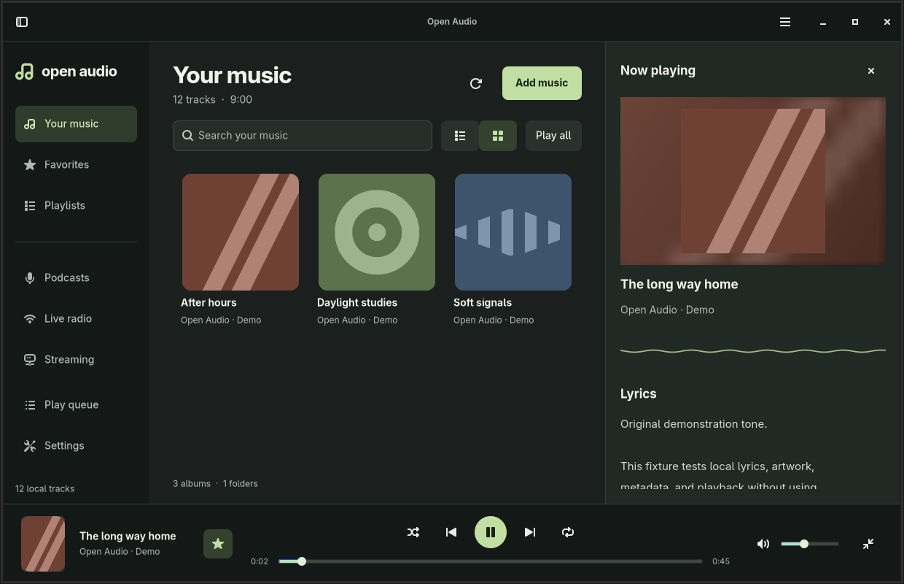

<div align="center">
  
  <h1>Open Audio Player</h1>
  <p>A native Linux home for your music, podcasts, and radio.</p>
  <p><strong>Rust · GTK 4 · GStreamer</strong></p>
</div>

Open Audio keeps a local library, internet audio, and desktop playback controls in one quiet interface. Choose your music folders, put something on, and keep listening in the mini player or system tray.



*The screenshot uses original, generated test tones and geometric artwork. No commercial music is bundled.*

[Get started](#get-started) · [Listening](#listening) · [Development](#development) · [Packaging](#packaging) · [Project layout](#project-layout)

## What works

| Area | Included |
| --- | --- |
| Local library | Recursive folder discovery and watching, file/folder drag and drop, Open location, metadata, search, track and album views, configurable automatic refresh, duplicate detection |
| Collections | Multi-selection and bulk actions, drag/keyboard reordering, favorites, playlist artwork grid, hover/focus Play all, create/rename/delete playlists, M3U/M3U8/PLS/XSPF import, queue, shuffle, repeat one/all |
| Playback | GStreamer audio, play/pause, previous/next, seeking, volume, mute, automatic next track, gapless, optional crossfade and ReplayGain |
| Podcasts | Apple Podcasts/iTunes and gPodder search/discovery, subscribe/unsubscribe toggles, RSS/Atom subscriptions, feed refresh, per-episode resume positions |
| Internet radio | Search and discovery through Radio Browser, station artwork, favorites, playback |
| Streaming | One view for YouTube Music, Spotify and direct HTTP(S) audio |
| YouTube Music | Song search, personal browser-session connection, native playback, two-way playlist sync and private playlist publishing |
| Spotify | Browser sign-in, librespot playback (Premium), track search, two-way playlist sync and private playlist publishing |
| Desktop | MPRIS controls and metadata, StatusNotifierItem tray menu, background playback, mini player |
| Artwork and lyrics | Embedded/folder/service covers, missing-cover lookup through MusicBrainz and Cover Art Archive, embedded/sidecar lyrics and LRCLIB lookup, local caching, artwork backdrop |
| Visualization | Live waveform from decoded PCM audio; no synthetic playback animation |
| Persistence | Library, sources, playlists, queue, track, position, volume, repeat, shuffle, and preferences |
| Languages | English, French, Spanish, German, Italian, Portuguese, Russian, Chinese, Japanese, Korean; new service copy falls back to English where untranslated |

**Service boundaries:** Spotify uses [librespot](https://github.com/librespot-org/librespot) and requires Premium. Search and playlist operations use Spotify’s Web API, whose account/app restrictions still apply. YouTube Music uses the unofficial `ytmusicapi` and `yt-dlp` libraries, with no API key or Premium subscription requirement in Open Audio Player. Availability depends on your account, region and YouTube; sessions can expire and provider changes can require dependency updates. Podcast downloads and synchronized lyric highlighting are not included. This is an initial implementation, not a published stable release.


### Provider access

These requirements apply to the features implemented in Open Audio Player. Anonymous access means no user account, API key, or saved sign-in is needed.

| Provider | Anonymous access | Account requirements |
| --- | --- | --- |
| [Apple Podcasts / iTunes](https://performance-partners.apple.com/search-api) | Yes: podcast search and discovery | None |
| [gPodder directory](https://gpoddernet.readthedocs.io/en/latest/api/reference/directory.html) | Yes: podcast search and top lists | None; subscriptions are stored locally |
| [Radio Browser](https://api.radio-browser.info/) | Yes: station search and discovery | None |
| [MusicBrainz](https://musicbrainz.org/doc/MusicBrainz_API) / [Cover Art Archive](https://musicbrainz.org/doc/Cover_Art_Archive/API) | Yes: metadata lookups and cover retrieval | None |
| [LRCLIB](https://lrclib.net/docs) | Yes: lyrics retrieval | None; developer registration is optional |
| [YouTube Music](https://ytmusicapi.readthedocs.io/en/stable/usage.html) | Partial: public search and eligible public-track playback | Personal playlist synchronization and publishing require a signed-in Google account |
| [Spotify](https://developer.spotify.com/documentation/web-api/concepts/authorization) | No: the integration requires sign-in | [Premium is required for librespot playback](https://github.com/librespot-org/librespot) |
| Direct RSS/Atom feeds and HTTP(S) audio streams | Yes, when the host serves them publicly | Host-dependent; authenticated feed login is not implemented |

YouTube playback uses [yt-dlp](https://github.com/yt-dlp/yt-dlp/wiki/Extractors#exporting-youtube-cookies); restricted content or service checks can require sign-in. Public podcast directory access does not unlock a publisher's paid or private episodes.

## Get started

Requires Linux, **Rust 1.85+**, **GTK 4.8+**, GStreamer with its base/good plugins, and FFmpeg. Audio format support depends on the installed GStreamer codecs. The development container supplies the native dependencies.

On Debian 12 / Ubuntu 24.04 or newer:

```sh
sudo apt install build-essential pkg-config libdbus-1-dev libgtk-4-dev \
  libgstreamer1.0-dev libgstreamer-plugins-base1.0-dev \
  gstreamer1.0-plugins-base gstreamer1.0-plugins-good \
  gstreamer1.0-plugins-bad gstreamer1.0-plugins-ugly \
  gstreamer1.0-libav gstreamer1.0-pulseaudio ffmpeg
```

With a current Rust toolchain installed:

```sh
cargo run --locked
```

Or build an optimized binary:

```sh
cargo build --release --locked
./target/release/open-audio-player
```

To add a folder at launch:

```sh
cargo run --locked -- --import "$HOME/Music"
```

### Enable YouTube Music

Install Python 3.10+ with venv support, `secret-tool` and a running desktop Secret Service keyring (GNOME Keyring or compatible). On Debian/Ubuntu:

```sh
sudo apt install python3-venv libsecret-tools
./scripts/setup-youtube-music.sh
```

Packaged installations include `open-audio-setup-youtube`. Run it again to update the optional dependencies. It installs `ytmusicapi` and `yt-dlp[default]` into a private virtual environment beside your library; it does not change system Python. Playback also needs **Deno 2.3+** (preferred) or **Node.js 22+** on `PATH`, as described in [yt-dlp’s runtime setup](https://github.com/yt-dlp/yt-dlp/wiki/EJS). The helper enables whichever is available.

1. Open **Streaming → YouTube Music**, search for a song or artist and press Enter. Double-click a result to play it through GStreamer; queue, favorites, pause, seek and next/previous work as usual. Public search does not need an account.
2. Select **Connect account**, open YouTube Music in your browser and sign in there. Choose that browser in Open Audio Player and connect. An optional profile path selects a nondefault profile. A Netscape-format cookie file is an alternative when the browser profile cannot be read. Close the browser before importing if its cookie database is locked.
3. Open **Your playlists → Sync playlists**. Online playlists appear in an artwork grid. Open one to browse or play its tracks. The global **Playlists** view also includes these linked collections.
4. Edit a linked playlist locally, then sync to upload its name and track changes. Online-only changes download on the next sync. Editing a read-only playlist or changing the same playlist on both sides produces a conflict and preserves both versions. Use **Replace local copy from YouTube Music** in its menu to explicitly accept the online version.
5. To publish a new local collection, add only YouTube Music tracks and choose **Publish privately to YouTube Music** from its card menu. It creates a private online playlist and links it for later sync. Local audio files cannot be uploaded through this feature.

Connection uses the first signed-in account in the selected browser profile; use a separate profile to select a different account. Google passwords are never entered into this app. Only YouTube-domain cookies are retained, in your desktop keyring. The library stores the account label, catalog metadata and playlist links; expiring audio URLs and credentials are not saved there. Imported cookie files are left untouched; protect or remove your export after connecting.

Sync runs when requested. Order and repeated tracks are preserved. Unavailable entries are reported, and incomplete playlists are left unchanged; the current safety limits are 250 playlists and 5,000 entries per playlist. Uploads add replacement entries before removing old ones, but network failures can leave a partial online update: check the online copy and refresh before retrying. Removing a linked playlist locally stops syncing it without deleting it online. **Account → Disconnect** clears the saved session and removes the local YouTube Music tracks and linked playlists; your online library is unchanged. Reconnect and sync to restore a removed local copy.

The embedded Python helper uses argument vectors and JSON pipes, never a shell. It resolves audio only when playback starts and does not download music files. `OPEN_AUDIO_PYTHON` can select an existing interpreter containing both libraries instead of the managed environment.

### Connect Spotify

1. Open **Streaming → Spotify → Connect account → Connect with Spotify**. A **Spotify Premium** account and an unlocked desktop Secret Service keyring (such as GNOME Keyring) are required. Spotify support is compiled into the application; no separate librespot executable, Python package or setup script is needed.
2. Sign in and approve access in your browser. The app uses authorization-code **PKCE**, a random state check, a loopback-only callback on `http://127.0.0.1:5588/login`, a three-minute deadline and a cancel button. No Spotify password is entered or stored in Open Audio Player. The refresh token stays in the desktop keyring; only account labels, catalog metadata and playlist links go in `library.json`.
3. Search for a song or artist and press Enter. Double-click a track to play. librespot decodes the audio and sends PCM to GStreamer, keeping volume, waveform, queue, shuffle/repeat, mini player and MPRIS controls shared with other sources. Search currently displays up to ten results. Track and linked-playlist menus include **Open in Spotify**.
4. Select **Your playlists → Sync playlists** to import accessible playlists. Edit a linked playlist locally and sync to upload track order and name changes. Online-only changes download; conflicting changes and local edits made during a sync are preserved. **Replace local copy from Spotify** explicitly discards local edits. Use **Publish privately to Spotify** on a local playlist containing only Spotify tracks to create an online copy.

Uploads are restricted to owned playlists containing only available Spotify tracks. Local files and podcast episodes cannot be uploaded; skipped entries are reported and make the imported playlist read-only for uploading. Sync fetches complete paginated collections, up to 500 playlists and 5,000 entries per playlist, preserving order and repeats. Large uploads use Spotify’s 100-item batches; an interrupted upload can leave a partial online update while keeping the local copy. Inspect the online copy before retrying. Removing a linked playlist locally stops its synchronization without deleting it online; disconnect and reconnect to import it again.

**Account → Disconnect** removes saved sign-in, Spotify tracks and linked playlists from this computer. Existing sign-in is restored in the background at startup, without starting playback. Search and sync show connection, permission and rate-limit failures instead of treating failed requests as empty collections.

By default, sign-in uses librespot’s public OAuth client. If Spotify denies catalog or playlist access, **Advanced connection options** accepts a Spotify developer Client ID (`OPEN_AUDIO_SPOTIFY_CLIENT_ID` can prefill it). Register the exact callback above; no client secret is needed. Spotify’s [current development-mode rules](https://developer.spotify.com/documentation/web-api/tutorials/february-2026-migration-guide) limit apps/users and may restrict playlist contents to owned or collaborative playlists. A custom Client ID does not bypass those limits. Spotify can also change unofficial-client access.

Offline tests cover authentication callback validation, playlist conflicts, stale responses, PCM output and the GTK flows. A real Premium account is still needed to verify end-to-end browser sign-in, live Spotify playback and online playlist writes; these have not been validated with a live account in this implementation session.

## Listening

1. Select **Add music** and choose a folder, or drop local audio files/folders onto the window. Dropped folders are added to your music folders; individual files import only the selected files. Scanning runs in the background; additional folders are managed in **Settings**.
2. Single-click to select a track or album. Double-click a track to play, or double-click an album to open its tracks. Use **Back** to return to the album grid. Playback keeps the list's scroll position; playing a track from a filtered queue preserves the whole queue.
3. Use the star to save a favorite. The track menu adds to the queue or a playlist. Removing a local track only removes its index entry; refreshing its folder can discover it again.
4. Select **Podcasts → Discover podcasts**. Choose **Apple Podcasts** (the iTunes directory) or **gPodder**, search by title, topic, or creator, then select **Subscribe**. The same button changes to **Unsubscribe**; unsubscribing retains indexed episodes and ignores any feed refresh still in flight. **Your episodes** lists subscribed episodes. You can also add any RSS or Atom feed URL. Use **Refresh** to fetch new episodes. Removing a subscription stops refreshes and retains previously indexed episodes.
5. Select **Live radio → Discover radio**, or type a station name and press Enter. Radio results are provided by the community-maintained [Radio Browser directory](https://www.radio-browser.info/).
6. Select **Streaming** for YouTube Music and Spotify. **Streaming → Internet streams → Add stream** accepts an HTTP(S) audio address or station URL. The sidebar remembers the last streaming service you used.

Use **Ctrl + click** for separate tracks or **Shift + click** for a range. The selection bar plays the selection, adds it to the queue or a playlist, changes favorites, or removes entries. Removing from a playlist/queue affects that collection; removing from Favorites only unstars tracks. Library removal removes index entries and their collection references, leaving files on disk. A local track's options menu includes **Open location**, which reveals the file in your file manager or opens its containing folder.

**Settings → Music folders → Watch music folders for changes** is on by default. Additions, metadata/sidecar changes and removals are detected recursively in the background; bursts of file operations are grouped before scanning. A startup scan catches changes made while the app was closed. Unavailable folders retain their indexed tracks. Symbolic links inside watched trees are not followed. Individual dropped files outside configured music folders are imported once; add their folder to watch future changes. Removing a folder in Settings stops watching it without deleting files or existing library entries.

Click the current cover to open the artwork, waveform, and lyrics panel. Put `cover.jpg`, `cover.png`, `folder.jpg`, or `folder.png` beside an album, or use embedded artwork. A lyrics sidecar must share the audio filename: `Song.flac` and `Song.lrc`. Folder watching picks up new sidecars; use **Refresh** if watching is off. LRC text is displayed as supplied.

Missing covers and lyrics are fetched automatically in the background for local music, Spotify and YouTube Music. Existing embedded, sidecar and service-provided content takes priority. Podcasts, radio and generic streams are excluded from these metadata searches.

| Provider | What it adds | Matching |
|---|---|---|
| [MusicBrainz](https://musicbrainz.org/doc/MusicBrainz_API) + [Cover Art Archive](https://musicbrainz.org/doc/Cover_Art_Archive/API) | Album covers for the current track and visible tracks/albums/playlists | Tagged MusicBrainz release ID when available; otherwise album artist (or track artist) and album, with alternate editions tried when artwork is absent |
| [LRCLIB](https://lrclib.net/docs) | Lyrics for the current track, including a restored session | Artist, title and duration within two seconds; album required when duration is unknown |

Neither lookup needs an account or API key. **Settings → Online artwork and lyrics** has independent switches, enabled by default. Disabling a lookup keeps previously downloaded content. Artist/album/title and, for lyrics, duration are sent to the corresponding provider; audio files are not uploaded. Requests identify Open Audio Player with its version and [project repository](https://github.com/fossgap/open-audio-player).

The detail panel links to the matched source and offers **Retry cover lookup** / **Retry lyrics lookup** for missing results or errors. Instrumental recordings are identified explicitly. Downloads and misses are cached under `metadata/` beside `library.json`; misses expire after seven days, and manual retry bypasses a cached miss. Temporary failures are not saved as misses. Requests are paced and respect provider backoff. Network failures do not stop playback. Downloaded synced lyrics retain their timing data in the cache and are displayed as plain text; synchronized highlighting is not implemented.


Scroll over the volume control to adjust volume by **5 percentage points** per wheel step. Scroll over the seek bar to move **5 seconds** per step. Up/right increases volume or moves forward; down/left decreases volume or moves backward. Seeking is disabled for sources without a known duration, and both controls clamp to their limits.

**Settings → Automatic refresh (minutes)** accepts **0–1440** minutes; **0** (the default) disables scheduled refresh, independently of local folder watching. A positive interval refreshes all saved music folders, podcast subscriptions, connected YouTube Music/Spotify playlists, and the open podcast/radio/streaming search view. Linked streaming playlists use their existing **two-way synchronization**, including eligible local edits and conflict handling. In-progress work is not duplicated; missing or expired streaming sign-ins never open an unattended login dialog. Changing the interval restarts the timer. Generic Internet stream URLs have no directory to refresh.

The session is restored without automatically starting audio. Press Play to continue. Podcast episodes also retain individual positions.

### Playback settings

**Settings → Playback** saves these preferences between sessions:

| Option | Default | Behavior |
|---|---|---|
| Gapless playback | On | Prepares the next queued song without restarting the audio output. Works between GStreamer music sources and between Spotify tracks; changing playback backends uses a normal transition. |
| Crossfade | Off (0 seconds) | Overlaps music for 1–12 seconds, with shorter fades for short songs. Applies to local music, YouTube Music and finite direct music streams. Podcasts, radio and repeat-one playback never crossfade. Spotify crossfade is not implemented. |
| ReplayGain | Off | Track gain evens out tagged tracks; Album gain preserves an album's relative levels and falls back to track gain when album tags are missing. Existing ReplayGain tags are read during playback, with peak protection when peak tags are present. Untagged audio is unchanged; no analysis or file rewriting takes place. Spotify uses librespot's own loudness data, with changes applied on the next track. |

Crossfade takes precedence over gapless for eligible transitions. Manual next/previous starts the selected song immediately; seeking ends any active overlap. Pause, mute and volume affect both songs during a fade. Queue edits, shuffle and repeat determine the prepared successor. If a speculative preload fails, ordinary next-track playback retries it.

YouTube Music resolves the next playback URL shortly before the transition, retaining its request headers. Network delays, expiring URLs and missing loudness tags can limit streaming transitions or normalization. These features add no provider accounts, subscriptions or API keys.

### Playlists

**Playlists** opens a grid of your collections, showing a member's artwork and the playlist name. Hover over an album or nonempty playlist card to reveal **Play all**; keyboard focus reveals the same button. It queues the whole collection and starts playback without opening or leaving the grid. Playlist order is retained unless shuffle is enabled. Click a playlist to see its tracks; double-click a track to play it. Use **New playlist** to create a collection and a track's options menu to add it. Rename or delete a playlist from its card menu or while viewing its tracks. In a compact window, these actions move into **Playlist options** beside the heading. Deletion asks for confirmation and retains the music files, library, and playing queue.

The **Import playlist** button beside **New playlist** accepts UTF-8 `.m3u`, `.m3u8`, `.pls`, and `.xspf` files. Relative paths resolve beside the playlist file; absolute paths, `file://` URLs, and HTTP(S) audio links are supported. Imports preserve order and existing track metadata and favorites. Missing, unsupported, and duplicate entries are skipped with a count. An imported name that already exists gets a numbered suffix. Importing creates a playlist without starting playback.

In a playlist or **Play queue**, drag a row's grip to reorder it. Select several tracks first to move them together; an insertion line marks the destination. The selection bar also provides up/down buttons and **Move to top/bottom** actions. Clear search before reordering. Reordering preserves the current playback; repeated tracks are separate entries for moving/removing. Edits to linked streaming playlists follow their existing synchronization and upload restrictions.

Apple discovery uses an initial podcast search; gPodder uses its public top list. Both support anonymous access without an account or API key. Results and feed availability depend on those services. A failed directory request offers connection and provider recovery; direct RSS subscription remains available.

Closing the main window keeps audio playing **only while playback is active and a compatible system tray is available**. Otherwise the application exits cleanly. On GNOME, a StatusNotifier/AppIndicator extension is needed for tray integration; MPRIS and the mini player work independently of the tray. Choose **Quit** to stop playback and exit explicitly.

### Keyboard shortcuts

| Shortcut | Action |
| --- | --- |
| Ctrl + Space | Play / pause |
| Alt + Left / Right | Previous / next |
| Alt + Up | Back to the album or playlist grid |
| Ctrl / Shift + click | Select separate tracks / a range |
| Ctrl + A | Select all tracks in the focused list |
| Escape | Clear track selection; close a settings or playlist dialog |
| Delete | Remove selected entries from the focused track list; keep files |
| Ctrl + Shift + Up / Down | Move selected playlist/queue entries one position |
| Ctrl + Shift + Home / End | Move selected playlist/queue entries to the top/bottom |
| Ctrl + O | Add a music folder |
| Ctrl + F | Focus search |
| Ctrl + R | Refresh the current source |
| Ctrl + L | Artwork and lyrics |
| Ctrl + M | Mini player |
| Ctrl + , | Settings |
| Ctrl + Q | Quit |

### Your data

The library is stored in `$XDG_DATA_HOME/open-audio-player/library.json`, defaulting to `~/.local/share/open-audio-player/library.json`. Cached service artwork lives in `artwork/` beside it; fetched covers, lyrics and lookup results live in `metadata/`. Saves use a temporary file, synchronization, and atomic replacement. A corrupt or unsupported library is reported and left untouched.

`OPEN_AUDIO_DATA_DIR=/some/directory` selects an isolated library, useful for testing. The app makes no directory or feed requests on first launch. Network requests begin when you explicitly discover/search podcasts or radio, subscribe/refresh a feed, or play an online source. With automatic lookups enabled, browsing saved music can fetch missing covers and selecting/restoring the current track can fetch missing lyrics. Searches go to the selected directory; result artwork may be fetched from its image hosts. If you enable automatic refresh, source updates and linked playlist synchronization run at that interval. Saved Spotify accounts also reconnect in the background at startup. There is no analytics collection. Existing playlists receive persistent identifiers automatically when an older library is loaded.

## Development

```sh
cargo fmt --check
cargo clippy --locked --all-targets -- -D warnings
cargo test --locked
python3 scripts/test-youtube-music.py
python3 scripts/check-locales.py
```

Install the Rust `rustfmt` and `clippy` components if your toolchain does not include them. GTK layouts are in `resources/*.ui`; behavior is in Rust and styling in `resources/style.css`. Layouts and translation catalogues are embedded in the binary, so changes require a rebuild.

### Test the actual application

Install `xvfb`, `xauth`, `dbus-x11`, `libglib2.0-bin` (for `gdbus`), `xdotool`, Python 3, and ImageMagick, then:

```sh
make smoke
make ui-test
```

The integration test generates original audio, starts local feed and podcast-directory fixtures, and drives the real application over D-Bus and keyboard input. It checks library and playlist import, metadata, artwork, playback, seek, pause, favorites, queue, playlist creation/renaming, both podcast directories, subscription toggles, empty/error states, MPRIS, mini mode, dialogs, compact layouts, and session restoration. The GTK regression test checks card Play all, wheel volume/seek limits, refresh scheduling, unsubscribe races, and artwork/lyrics against local provider fixtures, settings switches, attribution, retries, and compact detail-panel scrolling. It checks multi-selection, bulk playlist actions, typed file/track drops, duplicate-entry removal, file-manager requests, and live folder changes. It also scrolls long lists and checks that activation preserves scroll and selection, album browsing does not start playback, filtered queue playback retains its members, and playlist deletion respects cancellation. All library and audio data are temporary. External services and real audio hardware are not required.

The unit suite includes offline cover/lyric matching, positive/negative caching, invalid/oversized images, rate-limit backoff, cancellation, and Spotify authentication, catalog, sync and PCM-output checks; the display-dependent GTK regression runs separately through `make ui-test`. CI targets the Rust 1.85/GTK 4.8 Debian development container; native Linux checks include strict Clippy validation. The same integration suite can exercise native, release, and AppImage builds. The Arch recipe has not been built on Arch.

For review screenshots:

```sh
cargo build --locked
OPEN_AUDIO_SCREENSHOTS=/tmp/open-audio-screens make smoke
```

Set `OPEN_AUDIO_BINARY` to an absolute binary path to run the same checks against a release build or AppImage. Use `APPIMAGE_EXTRACT_AND_RUN=1` when FUSE is unavailable; this keeps the AppImage runtime's library and plugin environment intact.

`OPEN_AUDIO_ITUNES_API` and `OPEN_AUDIO_GPODDER_API` optionally replace the respective API base URLs for a private mirror or offline test server. The optional `OPEN_AUDIO_MUSICBRAINZ_API`, `OPEN_AUDIO_COVER_ART_API`, and `OPEN_AUDIO_LRCLIB_API` variables similarly replace metadata API bases. Normal use needs none of these settings.

To explore with a separate demonstration library:

```sh
python3 scripts/create-demo.py /tmp/open-audio-demo-music
OPEN_AUDIO_DATA_DIR=/tmp/open-audio-demo-state \
  cargo run --locked -- --import /tmp/open-audio-demo-music
```

### Docker and devcontainer

```sh
docker build -t open-audio-player-dev .
docker run --rm open-audio-player-dev
```

The default container command runs formatting, lint, unit, translation, and virtual-display integration checks. Open the repository in a Dev Containers compatible editor to use `.devcontainer/devcontainer.json`. The container is configured for headless testing; interactive windows and real audio require explicitly forwarding your display and audio session. Run natively for ordinary desktop listening.

### Translations

`locales/en.json` is the source catalogue; the other nine files use the same English keys. `scripts/check-locales.py` checks parity and literal UI coverage. Missing keys fall back to English. The system language is the default, or select a language in Settings and restart. Technical errors from external libraries and operating-system dialogs can remain in their own language.

## Packaging

Packaging recipes are supplied for all four requested formats. Build on the oldest distribution you intend to support: native library and glibc compatibility follow the build environment.

```sh
make deb       # requires dpkg-deb; writes a .deb to dist/
make rpm       # requires rpmbuild; writes an RPM to dist/
make arch      # writes a source archive and PKGBUILD to dist/
# On Arch Linux:
cd dist && makepkg -si
```

For AppImage, provide [linuxdeploy](https://github.com/linuxdeploy/linuxdeploy), its [GTK plugin](https://github.com/linuxdeploy/linuxdeploy-plugin-gtk), and its [GStreamer plugin](https://github.com/linuxdeploy/linuxdeploy-plugin-gstreamer). Install `patchelf`, `file`, `adwaita-icon-theme`, `glib-networking`, and the librsvg/GObject Introspection development packages (`librsvg2-dev libgirepository1.0-dev` on Debian). Put the two plugin executables on `PATH` (their `.sh` filenames are also accepted):

```sh
LINUXDEPLOY=/absolute/path/to/linuxdeploy-x86_64.AppImage make appimage
```

The recipe includes the application, GTK runtime via the plugin, Adwaita icons, FFmpeg, GIO's HTTPS module, and the build host's GStreamer plugins and their dependent libraries. `yt-dlp` remains an optional host dependency. Test an AppImage on a clean target system before distributing it. Arch packages and cross-distribution compatibility have not been release-qualified.

For a local installation:

```sh
make build
sudo make install
# Remove the installed binary and desktop assets; listening data is retained:
sudo make uninstall
```

A project distribution license has not yet been selected; package metadata intentionally does not invent one. Select a license and review bundled dependencies before publishing releases.

## Project layout

```text
src/
  app.rs         GTK controllers, playback, background work
  app/browse.rs  Track/album views, playlist management, podcast browser
  app/files.rs   Local file drops, folder watching controls, file manager
  app/selection.rs Multi-selection, bulk actions, playlist/queue reordering
  app/tests.rs   GTK scroll, selection, collection and streaming regressions
  app/spotify.rs Spotify account and playlist interface
  app/youtube.rs YouTube Music account and playlist interface
  audio.rs       Playback routing, next-track preparation and crossfades
  audio/         Gapless GStreamer decks, ReplayGain and PCM regression tests
  desktop.rs     MPRIS, StatusNotifierItem, and tray menu
  i18n.rs        Embedded translation catalogues
  enrichment.rs  Background cover/lyric jobs, cancellation, metadata matching
  enrichment/    MusicBrainz, Cover Art Archive, LRCLIB clients, cache and tests
  library.rs     Folder scanning, FFmpeg metadata, artwork, lyrics
  watch.rs       Recursive native GIO folder monitors on a worker thread
  collections.rs Occurrence-aware collection ordering and removal
  model.rs       Tracks, collections, queue, persisted session
  playlists.rs   M3U/M3U8, PLS, and XSPF parsing and import
  process.rs     Bounded subprocess execution without a shell
  services.rs    Podcast directories/feeds, Radio Browser and artwork
  spotify.rs     Background Spotify account/catalog service
  spotify/       PKCE, Web API catalog/sync and librespot PCM playback
  youtube_music.rs YouTube Music helper bridge and sync merge
  storage.rs     XDG data location and atomic state storage
resources/       GtkBuilder layouts, D-Bus interfaces, CSS, icon
locales/         Ten translation catalogues
packaging/       Desktop entry, AppStream metadata, RPM, Arch
scripts/         Packaging, fixtures, checks, integration tests
```

The [original product brief](docs/brief.md), including the Rhythmbox and Clementine references, is preserved.

Implementation references: [GTK list factories](https://gtk-rs.org/gtk4-rs/stable/0.10/docs/gtk4/struct.ListItemFactory.html), [GStreamer playbin](https://gstreamer.freedesktop.org/documentation/playback/playbin.html), [MPRIS specification](https://specifications.freedesktop.org/mpris/latest/Player_Interface.html), [Apple Search API](https://performance-partners.apple.com/search-api), [gPodder API](https://gpoddernet.readthedocs.io/en/latest/api/), and [Radio Browser API](https://docs.radio-browser.info/).
